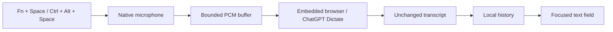

<div align="center">

# FlowGPT

### Speak. Keep your flow.

Native dictation for macOS and Windows that brings ChatGPT's Dictate recorder to your focused text field.

[](Docs/FLOWGPT_10.md)
[](Docs/WINDOWS_SETUP.md)
[](Package.swift)
[](CHANGELOG.md)
[](https://github.com/rachitkothadia/FlowGPT/actions/workflows/ci.yml)
[](https://github.com/rachitkothadia/FlowGPT/actions/workflows/windows.yml)
[](LICENSE)

[Download Mac DMG](https://github.com/rachitkothadia/FlowGPT/releases/download/v1.0.3/FlowGpt-1.0.3-arm64.dmg) · [Download Windows EXE](https://github.com/rachitkothadia/FlowGPT/releases/download/windows-v1.0.0-preview/FlowGPT-1.0.0-Windows-x64-Setup.exe) · [Get started](#get-started) · [Build from source](#build-from-source)


*Interface preview with sample data. Preview permission indicators are illustrative.*

</div>

## Your words, where you need them

Press **Fn + Space** on Mac or **Ctrl + Alt + Space** on Windows, speak, then press it again. FlowGPT captures your microphone, uses your signed-in ChatGPT website session for transcription, saves the result locally, and attempts to insert it into the field you started from.

Close the settings window and keep working. FlowGPT stays in the menu bar or Windows notification area; its compact recording strip shows microphone levels and becomes a loader while transcription finishes.

| Feature | What it does |
| --- | --- |
| Native microphone capture | Starts before browser or network preparation, with opening speech buffered in memory. |
| Persistent connection | Reuses the local WebKit or WebView2 ChatGPT profile across app launches. Expired sessions need sign-in again. |
| Focused-field insertion | Checks the original destination and attempts automatic insertion with clipboard restoration where supported. |
| Local history | Saves searchable transcripts on your computer before attempting insertion. |
| Quiet background operation | Keeps the connection renderer hidden and avoids reopening Settings after completion. |
| Connection recovery | Checks idle readiness and wake events, with bounded retries that protect active recordings and drafts. |
| Native appearance | SwiftUI/AppKit with Liquid Glass on supported Macs; C++/WinRT and WinUI 3 with Mica on Windows. |

> **Connection model:** this is an experimental embedded-browser bridge, not official ChatGPT OAuth or an OpenAI speech API integration. An embedded renderer remains active inside FlowGPT. Website UI changes, session expiry, account limits, and network availability can affect it. There is no guarantee of permanent login or unlimited usage. FlowGPT is an independent project, unaffiliated with OpenAI or Wispr.

## Get started

### Windows preview

**Requirements:** Windows 11, an Intel/AMD x64 PC, a ChatGPT account with Dictate available, and internet access.

1. [Download the Windows EXE installer](https://github.com/rachitkothadia/FlowGPT/releases/download/windows-v1.0.0-preview/FlowGPT-1.0.0-Windows-x64-Setup.exe). Run it to install for your Windows account; it includes the native runtime and checks Microsoft's WebView2 Runtime.
2. Open FlowGPT and choose **Continue with ChatGPT / Manage connection**. Sign in yourself, then close the connection window. Each user has their own local profile.
3. Enable desktop microphone access in Windows Settings if capture is denied. Choose your input device in FlowGPT Settings.
4. Test with **Test dictation here**, then focus a field in another app and use **Ctrl + Alt + Space** to start and finish.
5. Closing the window keeps the tray app running. Login startup is selected by default during installation and can be changed in Settings.

This first Windows preview is **unsigned**; Windows SmartScreen may show an unknown-publisher warning. Use the release checksum to verify the exact file. macOS quarantine commands do not apply to Windows. A trusted Windows signing certificate is required to establish a publisher identity; this build does not claim one.

Read [Windows setup and the friend test checklist](Docs/WINDOWS_SETUP.md) and [Windows verification evidence](Docs/WINDOWS_VALIDATION.md). Automated Windows fixtures check storage, paste, buffered browser audio, UI, and installation. Real microphone performance, a real signed-in ChatGPT transcription, and your friend's target editors still need testing on their PC.


*Captured from the running Windows app. The connection and history shown use an isolated test fixture, without a real ChatGPT account.*

### macOS

**Requirements:** macOS 14+, an Apple Silicon Mac for the current local DMG, a ChatGPT account with Dictate available, and an internet connection.

1. [Download FlowGpt-1.0.3-arm64.dmg](https://github.com/rachitkothadia/FlowGPT/releases/download/v1.0.3/FlowGpt-1.0.3-arm64.dmg) from the [1.0.3 preview release](https://github.com/rachitkothadia/FlowGPT/releases/tag/v1.0.3). This installer supports Apple Silicon; it is ad hoc signed and **not notarized**.
2. Drag **FlowGpt.app** into **Applications** and open it.
3. Choose **Continue with ChatGPT** and sign in yourself in the connection window.
4. Grant **Microphone**, **Accessibility**, and **Input Monitoring** to the installed app.
5. Put your cursor in an editable field. Press **Fn + Space** to record and again to finish.

Use **Test dictation here** first if you want a local preview without inserting into another app. When an editor cannot accept or confirm insertion, the transcript remains in History.

### If macOS blocks the downloaded app

After copying **FlowGpt.app into Applications**, try opening it and check **System Settings → Privacy & Security → Open Anyway**. If that option is unavailable, and you trust the copy downloaded from this repository, run this once in Terminal:

```sh
xattr -dr com.apple.quarantine "/Applications/FlowGpt.app" && open "/Applications/FlowGpt.app"
```

This removes the download quarantine flag only from FlowGpt and opens it. It bypasses the quarantine check for this copy; it does not notarize the app or disable Gatekeeper globally. The DMG does not run this command automatically. Microphone, Accessibility, and Input Monitoring still require your approval afterward.

The release includes a checksum file. Before installing, you can compare the downloaded DMG with it:

```sh
cd ~/Downloads
shasum -a 256 -c SHA256SUMS.txt
```

Download [SHA256SUMS.txt](https://github.com/rachitkothadia/FlowGPT/releases/download/v1.0.3/SHA256SUMS.txt) into the same folder as the DMG. Expected SHA-256 for this exact installer: `c29f6f95bed5871fcb2a20a010c20d7550926429f524a8295b25a61ba522e489`.

<details>
<summary><strong>Connection, permission, and installation troubleshooting</strong></summary>

- **App won't open:** the current local package is ad hoc signed and unnotarized, so downloaded copies can be blocked by Gatekeeper. Follow [Apple's app-opening guidance](https://support.apple.com/102445). A valid local signature is not equivalent to Developer ID notarization. See [public distribution](Docs/DISTRIBUTION.md).
- **Shortcut or insertion unavailable:** check the three permission rows against macOS Privacy & Security. Installing a rebuilt ad hoc app can require refreshed grants. FlowGPT does not reset the privacy database.
- **Connection expired:** open Settings → Manage connection and sign in again. The saved website session can be revoked by ChatGPT.
- **Opening words or processing delay:** local recording starts before the browser, but transcription still depends on ChatGPT. Unsent native audio is bounded to 30 seconds; overflow reports an error rather than silently dropping speech.
- **No text appears:** check History. Some custom editors do not support insertion or allow verification. Password fields, read-only fields, and changed destinations are refused.

</details>

## How it works



Swift's capture-only `AVCaptureSession` on Mac and C++ WASAPI capture on Windows deliver 16 kHz mono PCM. A Web Audio stream feeds those samples to ChatGPT's page recorder. When you finish, FlowGPT stops native capture, drains queued samples, and waits for the unsent composer transcript.

The result is saved locally before the matching draft is cleared or insertion is attempted. **FlowGPT does not send a ChatGPT message.** It does not scrape existing conversations or extract login tokens. No separate browser, Selenium process, MCP server, Groq request, or local language-prediction layer participates in the current dictation path.

The transcript is delivered unchanged. There is no extra formatter imposing English/Hindi script conversion, bullets, or corrections. Language accuracy and formatting depend on ChatGPT's transcription.

### Measured startup, with clear limits

| Check on the development Mac | Result |
| --- | --- |
| First actual audio frame, installed-app diagnostic, five starts | **57–167 ms** |
| Live signed-in ChatGPT recorder startup, one check | **382 ms** |
| Native software tests at the 1.0.3 validation | **110 passed** |
| Synthetic WebKit audio/DOM checks | **50 passed** |
| Connection recovery / window lifecycle fixtures | **6 / 10 passed** |

These are startup measurements and software checks, not accuracy scores or universal latency promises. The live bridge check cancelled recording; it did not establish completed transcription or cross-app paste. Global shortcut/paste verification on that final build remained pending permission setup. Multi-hour recording and long-term live outage recovery are not validated. See the [full validation report](Docs/FLOWGPT_103_VALIDATION.md).

## Interface

<table>
<tr>
<td width="50%"></td>
<td width="50%"></td>
</tr>
<tr><td align="center">Connection and permissions</td><td align="center">Compact recording strip</td></tr>
</table>

*Screenshots use isolated visual fixtures with sample history; they do not expose a real account or microphone session.*

## Build from source

The Windows project is under [`Windows/`](Windows/). See [Windows build instructions](Docs/WINDOWS_SETUP.md#build-on-windows). Native WinUI compilation needs a Windows toolchain; portable policy checks can also run on macOS. The Windows pipeline builds and tests the actual EXE installer.

For macOS:

Install Swift 6.2+ and a compatible macOS SDK through Xcode or Command Line Tools. The package has no third-party Swift dependencies.

```sh
git clone https://github.com/rachitkothadia/FlowGPT.git
cd FlowGPT
Scripts/test.sh
Scripts/build-flowgpt.sh
```

The local builder creates **FlowGpt-1.0.3-arm64.dmg in the project root**. Build/test logs and the staged app stay under `release/flowgpt/`. This local build is ad hoc signed by default and is not suitable for frictionless public distribution.

For an isolated UI preview with sample data and no microphone or sign-in:

```sh
swift run FlowGpt --design-preview
```

### Public distribution

The universal distribution script requires an installed **Developer ID Application** certificate and stored `notarytool` credentials. It builds both architectures, signs and notarizes the app, packages a signed DMG, and verifies the notarization ticket. Apple credentials are not included in this repository.

```sh
export FLOW_SIGNING_IDENTITY="Developer ID Application: Your Name (TEAM_ID)"
export FLOW_NOTARY_PROFILE="flowgpt-notary"
Scripts/build-distribution.sh
```

See [signing and notarization setup](Docs/DISTRIBUTION.md). Universal compilation and Apple notarization must succeed before the output is called a public release. Intel runtime behavior still needs testing on a real Intel Mac.

## Privacy

- Audio is sent to OpenAI through ChatGPT's website for transcription.
- Native audio is buffered in memory during dictation, without a local recording file in this current path.
- Website login data is managed locally by the embedded browser. Mac transcripts are under `~/Library/Application Support/Flow/`; Windows transcripts, settings, and the WebView2 profile are under `%LOCALAPPDATA%\FlowGPT\`.
- Temporary Chat is verified before recording, but does not guarantee zero OpenAI retention. See [OpenAI's Temporary Chat guidance](https://help.openai.com/en/articles/8914046-temporary-chat-faq).
- The historical `in.vardaan.flow` bundle ID and `Flow` data folder are retained to preserve existing sessions and history.
- Legacy API and lecture code remains in the source tree for historical reference. It is not the active FlowGPT bridge. Older personal data is not deleted automatically.

## Project map

```text
Sources/FlowApp/       Native UI, microphone, WebKit bridge, shortcuts, insertion
Sources/FlowCore/      Session state, persistence, recovery, shared policies
Sources/FlowQA/        Developer diagnostics and historical API checks
Tests/FlowCoreTests/   Native regression suite
Scripts/              Build, package, and distribution tools
Resources/            App metadata, icon generation inputs, entitlements
Windows/              C++/WinRT app, WinUI UI, WASAPI, WebView2 bridge, EXE installer
Docs/                 Setup, architecture evidence, release notes, screenshots
```

Start with [ChatGPTBrowser.swift](Sources/FlowApp/ChatGPTBrowser.swift), [NativeBrowserMicrophone.swift](Sources/FlowApp/NativeBrowserMicrophone.swift), and [BrowserDictation.swift](Sources/FlowCore/BrowserDictation.swift). Older `FLOW_*` reports describe retired versions; current setup is [FLOWGPT_10.md](Docs/FLOWGPT_10.md).

## Contributing

Bug reports should include your macOS version, processor, FlowGPT version, and a reproducible example with private content removed. Read [CONTRIBUTING.md](CONTRIBUTING.md) before changing the capture, insertion, or signing path. Please report sensitive issues through the instructions in [SECURITY.md](SECURITY.md).

Licensed under [MIT](LICENSE). Built by [Rachit Kothadia](https://github.com/rachitkothadia).
