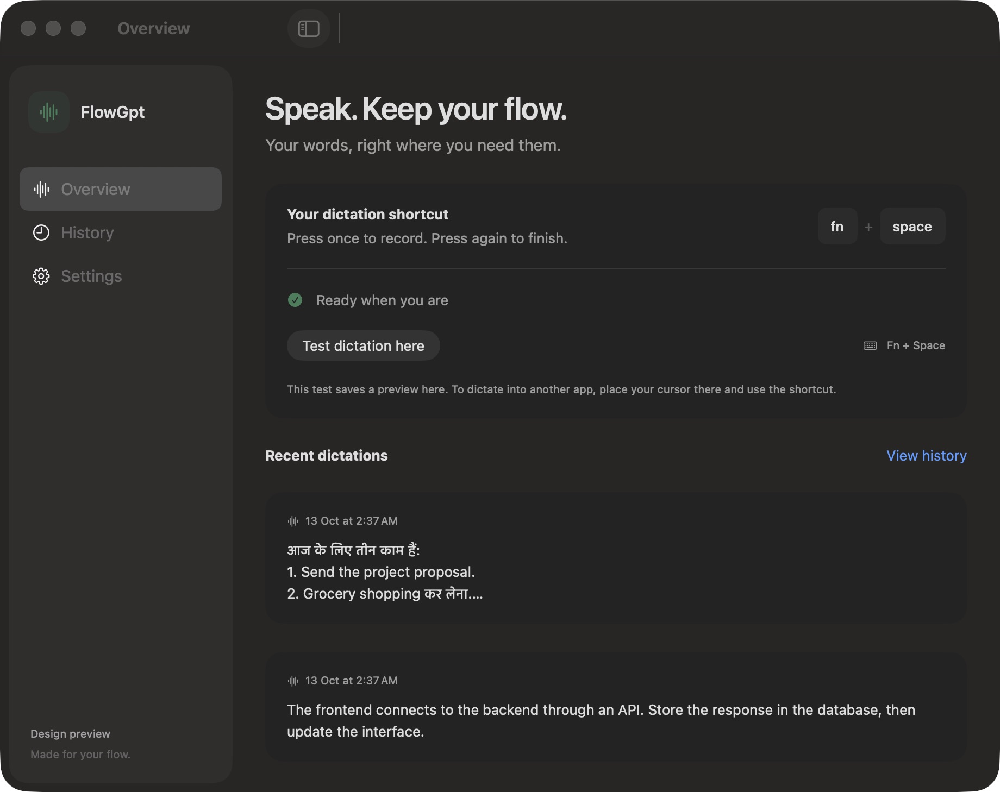
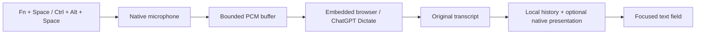
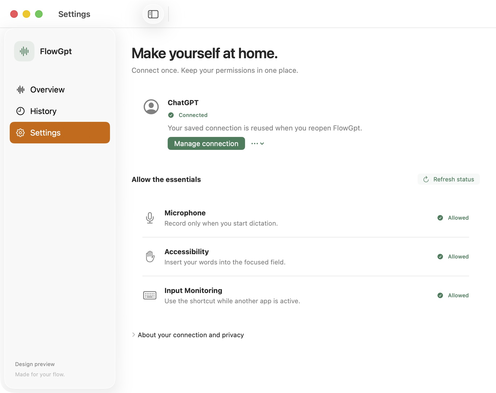
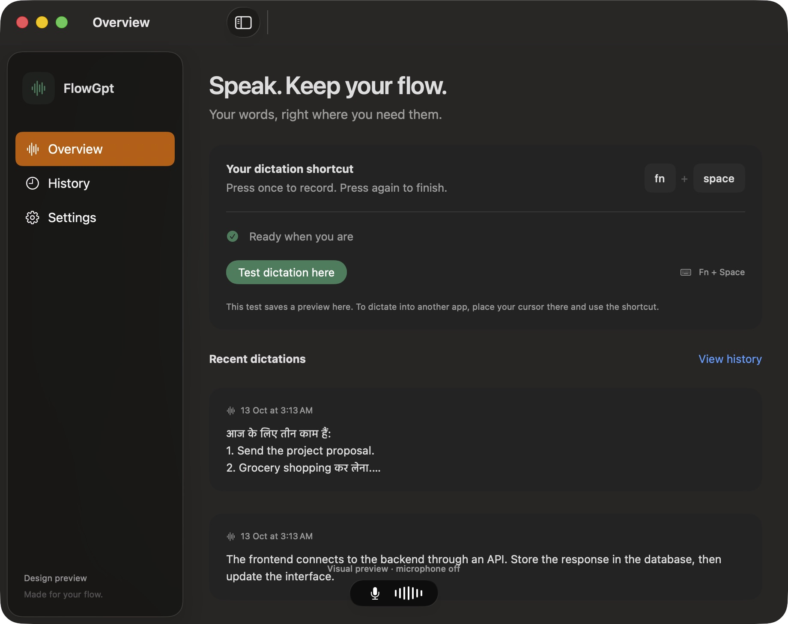
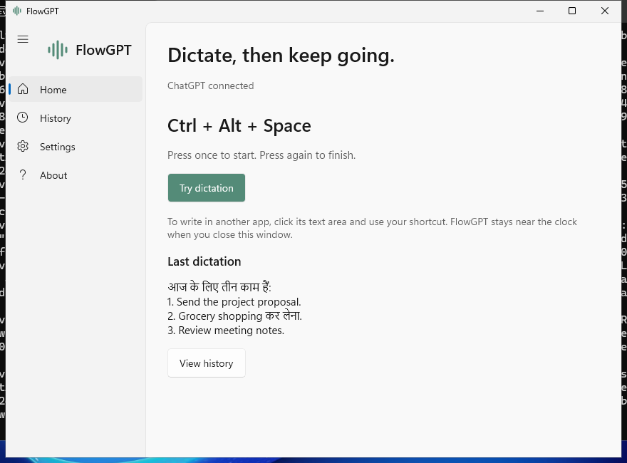

<div align="center">

# FlowGPT

### Speak. Keep your flow.

Native dictation for macOS and Windows that brings ChatGPT's Dictate recorder to your focused text field.

[](Docs/FLOWGPT_10.md)
[](Docs/WINDOWS_SETUP.md)
[](Package.swift)
[](CHANGELOG.md)
[](https://github.com/rachitkothadia/FlowGPT/actions/workflows/ci.yml)
[](https://github.com/rachitkothadia/FlowGPT/actions/workflows/windows.yml)
[](LICENSE)

[Download for Mac](https://github.com/rachitkothadia/FlowGPT/releases/download/v1.1.0/FlowGpt-1.1.0-arm64.dmg) · [Download for Windows](https://github.com/rachitkothadia/FlowGPT/releases/download/windows-v1.1.0-preview/FlowGPT-1.1.0-Windows-x64-Setup.exe) · [Installation](#installation) · [Features](#features)



*Earlier interface preview with sample data. Version 1.1 uses Home, History, Settings and About. Preview permission indicators are illustrative.*

</div>

## Installation

Choose your computer below. You need internet access and your own ChatGPT account with dictation available. **No API key is needed.**

### Windows

**Works on Windows 11, on an Intel or AMD 64-bit PC.**

1. **[Download FlowGPT for Windows (.exe)](https://github.com/rachitkothadia/FlowGPT/releases/download/windows-v1.1.0-preview/FlowGPT-1.1.0-Windows-x64-Setup.exe).**
2. **Install it.** Double-click the downloaded file, follow the installer, then open **FlowGPT** from the Start menu.
3. **Connect ChatGPT.** Click **Connect ChatGPT**, sign in to your account, then close the connection window.
4. **Allow your microphone if recording is blocked.** Open **Windows Settings → Privacy & security → Microphone**. Turn on **Microphone access** and **Let desktop apps access your microphone**.
5. **Dictate.** Click the text box you want to type into. Press **Ctrl + Alt + Space**, speak, then press the same shortcut again to finish. You can choose **Ctrl + Space** in Settings.

*This Windows release is an unsigned preview. If Windows shows a security warning, see the help below.*

### Mac

**Works on macOS 14 or newer, on an Apple Silicon Mac (M1 or later).**

1. **[Download FlowGPT for Mac (.dmg)](https://github.com/rachitkothadia/FlowGPT/releases/download/v1.1.0/FlowGpt-1.1.0-arm64.dmg).** Double-click the downloaded file.
2. **Install it.** Drag **FlowGpt.app** into **Applications**, then open it from Applications.
3. **Connect ChatGPT.** Click **Connect ChatGPT**, sign in to your account, then close the connection window.
4. **Allow the three permissions.** Enable **Microphone**, **Accessibility**, and **Input Monitoring** for FlowGpt when prompted. You can also find them in **System Settings → Privacy & Security**.
5. **Dictate.** Click the text box you want to type into. Press **Fn + Space**, speak, then press the same shortcut again to finish.

*The Mac release is not notarized by Apple yet. If it won't open, see the help below.*

**After setup:** you can close FlowGPT's main window and keep using the shortcut. Open it again from the Mac menu bar or the Windows tray near the clock. Your transcripts are saved in **History**, including when insertion into another app fails.

### Need help installing?

<details>
<summary><strong>Mac says the app cannot be opened</strong></summary>

Make sure you have dragged **FlowGpt.app into Applications** first.

Try opening it, then go to **System Settings → Privacy & Security → Open Anyway**. See [Apple's instructions](https://support.apple.com/102445).

If **Open Anyway** is missing, and you trust the app downloaded from this repository, open **Terminal**, paste this line, and press Return:

```sh
xattr -dr com.apple.quarantine "/Applications/FlowGpt.app" && open "/Applications/FlowGpt.app"
```

This removes the download quarantine flag from FlowGpt only. It does not grant microphone or typing permissions; complete step 4 afterward.

</details>

<details>
<summary><strong>Windows shows a warning or the microphone is blocked</strong></summary>

The preview is unsigned, so Windows may warn that the publisher is unknown. If you see **Windows protected your PC** and trust this repository's download, click **More info → Run anyway**, if available. See [Microsoft's guidance](https://learn.microsoft.com/en-us/windows/apps/package-and-deploy/publish-first-app#step-6-handle-smartscreen-for-new-apps). Some security policies may block unsigned apps; this installer cannot override them.

For microphone problems, check **Settings → Privacy & security → Microphone** and enable **Microphone access** and **Let desktop apps access your microphone**. In **FlowGPT → Settings**, select the microphone you want to use. See [Microsoft's microphone guide](https://support.microsoft.com/en-us/windows/privacy/turn-on-app-permissions-for-your-microphone-in-windows).

The installer checks the required Microsoft WebView2 Runtime automatically. Keep your internet connection on during installation.

</details>

<details>
<summary><strong>The shortcut works, but no text appears</strong></summary>

- Open **History** to find your transcript.
- Try **Try dictation / Try recording** in FlowGPT to check recording without another app.
- If the ChatGPT connection has expired, open **Manage connection** and sign in again.
- On Mac, check **Accessibility** and **Input Monitoring** for FlowGpt. On Windows, try another shortcut in FlowGPT Settings if the current one is unavailable.
- Keep the destination field focused. Password fields, read-only fields, and some protected/custom editors cannot accept insertion.

</details>

<details>
<summary><strong>Verify the downloaded installer (optional)</strong></summary>

Each release includes a **SHA256SUMS.txt** file alongside its installer:

- [Mac installer and checksum](https://github.com/rachitkothadia/FlowGPT/releases/tag/v1.1.0)
- [Windows installer and checksum](https://github.com/rachitkothadia/FlowGPT/releases/tag/windows-v1.1.0-preview)

On Mac, download the DMG and its checksum into Downloads, then run:

```sh
cd ~/Downloads
shasum -a 256 -c SHA256SUMS.txt
```

On Windows, open PowerShell in Downloads and compare this result with the Windows checksum file:

```powershell
Get-FileHash .\FlowGPT-1.1.0-Windows-x64-Setup.exe -Algorithm SHA256
```

</details>

## Features

Speak into the field you are working in. FlowGPT records your voice, gets the transcription from your ChatGPT connection, saves it locally, and attempts to insert it into that field.

| Feature | What it does |
| --- | --- |
| Microphone recording | Buffers opening speech while the connection prepares. |
| Saved connection | Keeps your own ChatGPT sign-in locally between launches. Expired sessions need sign-in again. |
| Automatic insertion | Attempts to insert into your original field and restores the clipboard where supported. |
| Local history | Saves searchable transcripts and the original returned text on your computer. |
| Conservative formatting | Adds line breaks to explicit consecutive numbered items; preserves words, repetitions, scripts, names, and code. |
| Updates | Checks GitHub releases and verifies downloads. Windows opens the installer; Mac opens the DMG for manual replacement. |
| Background operation | Keeps running in the menu bar or tray when you close the main window. |
| Compact recording strip | Shows microphone levels, then a loader while transcription finishes. |
| Native interface | A Mac interface with Liquid Glass where supported, and a Windows interface built with WinUI 3. |

## How it works

> **Connection model:** FlowGPT uses an experimental embedded-browser bridge, not official ChatGPT OAuth or an OpenAI speech API. The embedded renderer stays active inside FlowGPT. Website changes, session expiry, account limits, and internet availability can affect it. Permanent login and unlimited usage are not guaranteed. FlowGPT is independent of OpenAI and Wispr.



Swift's capture-only `AVCaptureSession` on Mac and C++ WASAPI capture on Windows deliver 16 kHz mono PCM. A Web Audio stream feeds those samples to ChatGPT's page recorder. When you finish, FlowGPT stops native capture, drains queued samples, and waits for the unsent composer transcript.

The result is saved locally before the matching draft is cleared or insertion is attempted. **FlowGPT does not send a ChatGPT message.** It does not scrape existing conversations or extract login tokens. No separate browser, Selenium process, MCP server, Groq request, or local language-prediction layer participates in the current dictation path.

The original transcript is retained in History. Instant native formatting only adds line breaks around already explicit consecutive numbered items. It preserves words, order, repetitions, self-corrections, languages and scripts; quoted text, code, URLs and paths stay untouched. There is no extra AI request, translation, guessed correction, or invented list. Speech recognition accuracy still depends on ChatGPT's transcription.

In version 1.1, text-field checks run separately from the Windows UI, clipboard restoration no longer keeps the loader visible, and the Windows release's reported stop crash has a [matching-binary diagnosis and regression test](Docs/WINDOWS_100_CRASH.md). Mac Word insertion was independently verified with complete Hindi/English/Marathi text. Ambiguous PowerPoint canvas focus remains unsupported on the tested Mac; Windows Office still needs a real-device check. See [1.1 validation](Docs/FLOWGPT_11_VALIDATION.md).

### Verification

| Check | Result |
| --- | --- |
| Mac 1.1 software suite | **120 tests passed** |
| Mac 1.1 Word insertion adapter, three real document checks | **23–113 ms**, exact text and clipboard restoration verified |
| Windows 1.1 portable policies | **79 checks passed** |
| Windows 1.1 native / UI / installer checks | **52 / 17 / 11 passed**, including the released 1.0-to-1.1 upgrade |
| Mac 1.1 real microphone startup, five starts | **116–458 ms** to the first audio frame |
| Mac 1.1 isolated browser/window checks | **50 / 10 passed** |

Earlier startup evidence, from the development Mac on version 1.0.3:

| Check | Result |
| --- | --- |
| First actual audio frame, installed-app diagnostic, five starts | **57–167 ms** |
| Live signed-in ChatGPT recorder startup, one check | **382 ms** |
| Native software tests at the 1.0.3 validation | **110 passed** |
| Synthetic WebKit audio/DOM checks | **50 passed** |
| Connection recovery / window lifecycle fixtures | **6 / 10 passed** |

These are startup measurements and software checks, not accuracy scores or universal latency promises. The live bridge check cancelled recording; it did not establish completed transcription or cross-app paste. Global shortcut/paste verification on that final build remained pending permission setup. Multi-hour recording and long-term live outage recovery are not validated. See the [historical startup report](Docs/FLOWGPT_103_VALIDATION.md) and [current release validation](Docs/FLOWGPT_11_VALIDATION.md).

## Interface

<table>
<tr>
<td width="50%"></td>
<td width="50%"></td>
</tr>
<tr><td align="center">Connection and permissions</td><td align="center">Compact recording strip</td></tr>
</table>

*Screenshots use isolated visual fixtures with sample history; they do not expose a real account or microphone session.*



*The Windows screenshot uses an isolated test connection and sample history.*

Read [Windows setup and the friend test checklist](Docs/WINDOWS_SETUP.md) and [current verification evidence](Docs/FLOWGPT_11_VALIDATION.md) for detailed checks. Real microphone performance, signed-in ChatGPT transcription, and your target editors still need testing on your Windows PC.

## Build from source

The Windows project is under [`Windows/`](Windows/). See [Windows build instructions](Docs/WINDOWS_SETUP.md#build-on-windows). Native WinUI compilation needs a Windows toolchain; portable policy checks can also run on macOS. The Windows pipeline builds and tests the actual EXE installer.

For macOS:

Install Swift 6.2+ and a compatible macOS SDK through Xcode or Command Line Tools. The package has no third-party Swift dependencies.

```sh
git clone https://github.com/rachitkothadia/FlowGPT.git
cd FlowGPT
Scripts/test.sh
Scripts/build-flowgpt.sh
```

The local builder creates **FlowGpt-1.1.0-arm64.dmg in the project root**. Build/test logs and the staged app stay under `release/flowgpt/`. This local build is ad hoc signed by default and is not suitable for frictionless public distribution.

For an isolated UI preview with sample data and no microphone or sign-in:

```sh
swift run FlowGpt --design-preview
```

### Public distribution

The universal distribution script requires an installed **Developer ID Application** certificate and stored `notarytool` credentials. It builds both architectures, signs and notarizes the app, packages a signed DMG, and verifies the notarization ticket. Apple credentials are not included in this repository.

```sh
export FLOW_SIGNING_IDENTITY="Developer ID Application: Your Name (TEAM_ID)"
export FLOW_NOTARY_PROFILE="flowgpt-notary"
Scripts/build-distribution.sh
```

See [signing and notarization setup](Docs/DISTRIBUTION.md). Universal compilation and Apple notarization must succeed before the output is called a public release. Intel runtime behavior still needs testing on a real Intel Mac.

## Privacy

- Audio is sent to OpenAI through ChatGPT's website for transcription.
- Native audio is buffered in memory during dictation, without a local recording file in this current path.
- Website login data is managed locally by the embedded browser. Mac transcripts are under `~/Library/Application Support/Flow/`; Windows transcripts, settings, and the WebView2 profile are under `%LOCALAPPDATA%\FlowGPT\`.
- Temporary Chat is verified before recording, but does not guarantee zero OpenAI retention. See [OpenAI's Temporary Chat guidance](https://help.openai.com/en/articles/8914046-temporary-chat-faq).
- The historical `in.vardaan.flow` bundle ID and `Flow` data folder are retained to preserve existing sessions and history.
- Legacy API and lecture code remains in the source tree for historical reference. It is not the active FlowGPT bridge. Older personal data is not deleted automatically.

## Project map

```text
Sources/FlowApp/       Native UI, microphone, WebKit bridge, shortcuts, insertion
Sources/FlowCore/      Session state, persistence, recovery, shared policies
Sources/FlowQA/        Developer diagnostics and historical API checks
Tests/FlowCoreTests/   Native regression suite
Scripts/              Build, package, and distribution tools
Resources/            App metadata, icon generation inputs, entitlements
Windows/              C++/WinRT app, WinUI UI, WASAPI, WebView2 bridge, EXE installer
Docs/                 Setup, architecture evidence, release notes, screenshots
```

Start with [ChatGPTBrowser.swift](Sources/FlowApp/ChatGPTBrowser.swift), [NativeBrowserMicrophone.swift](Sources/FlowApp/NativeBrowserMicrophone.swift), and [BrowserDictation.swift](Sources/FlowCore/BrowserDictation.swift). Older `FLOW_*` reports describe retired versions; current Mac setup is [MAC_11.md](Docs/MAC_11.md).

## Contributing

Bug reports should include your operating system version, processor, FlowGPT version, and a reproducible example with private content removed. Read [CONTRIBUTING.md](CONTRIBUTING.md) before changing the capture, insertion, or signing path. Please report sensitive issues through the instructions in [SECURITY.md](SECURITY.md).

Licensed under [MIT](LICENSE). Built by [Rachit Kothadia](https://github.com/rachitkothadia).
